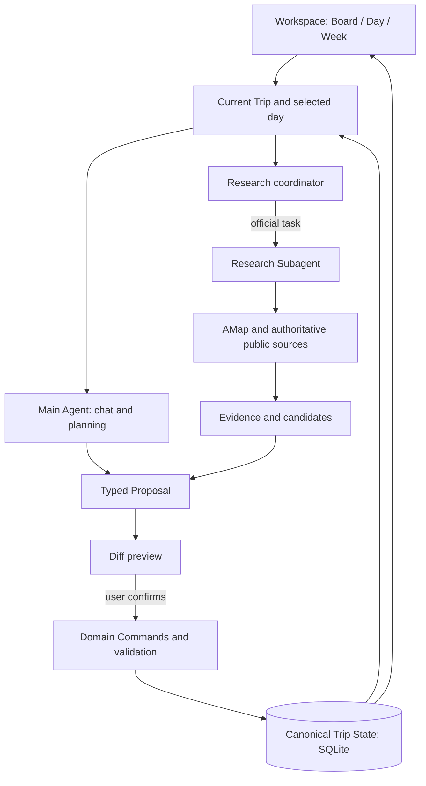

<h1 align="center">BrandonTravel</h1>

<p align="center"><strong>An AI-native travel planning workspace</strong></p>

<p align="center"><strong>Plan with structure. Explore with AI. Stay in control.</strong></p>

<p align="center">Build an editable multi-day plan, refine each day with chat and a map, and research new places with evidence. Review AI suggestions and choose what becomes part of your trip.</p>

<p align="center">
  <a href="#three-moments-one-trip"><strong>▶ Watch the demos</strong></a> &nbsp; · &nbsp;
  <a href="docs/agent-learning/portfolio-guide.md"><strong>Documentation</strong></a>
</p>

<p align="center">
  <a href="README.zh-CN.md">简体中文</a> &nbsp; · &nbsp;
  <a href="#try-it">Try it</a> &nbsp; · &nbsp;
  <a href="#how-it-works">How it works</a> &nbsp; · &nbsp;
  <a href="docs/PORTFOLIO_EVIDENCE.md">Engineering evidence</a>
</p>

<p align="center">
  <a href="docs/screenshots/portfolio/hero.png"></a>
</p>

## An AI-native travel planning workspace

**Plan with structure. Explore with AI. Stay in control.**

Build an editable multi-day plan, refine each day with chat and a map, and research new places with evidence. Review AI suggestions and choose what becomes part of your trip.

[简体中文](README.zh-CN.md) · [Watch the demos](#three-moments-one-trip) · [Try it](#try-it) · [How it works](#how-it-works) · [Engineering evidence](docs/PORTFOLIO_EVIDENCE.md)


## Why BrandonTravel?

Trips change: new discoveries, slower mornings, different needs. A generated itinerary is a starting point; keeping it useful takes ongoing research and adjustment.

BrandonTravel gives that plan a structured workspace. Edit it directly while AI reads the current itinerary, explores options and proposes changes for you to approve.

## Three moments, one trip

<p align="center">
  <a href="docs/screenshots/readme/product-overview.png"></a>
</p>

### 01 · From an idea to an editable blueprint

Start with a name; add **where, when and who** as you decide. Generate a multi-day draft, review its changes and assumptions, then confirm. Drag activities between days or continue by hand.

<p align="center">
  <a href="docs/screenshots/portfolio/board.png"></a>
</p>

<p align="center">
  <a href="docs/demos/blueprint.gif">▶ Watch blueprint → confirmation · 22s</a> &nbsp; · &nbsp;
  <a href="docs/demos/blueprint.webm">Original recording</a> &nbsp; · &nbsp;
  <a href="docs/screenshots/portfolio/board.png">Full screenshot</a>
</p>

### 02 · Make each day workable

Use **chat, timeline and map** together. Adjust times and activity order, inspect travel references, or ask Brandon to propose changes for the selected day. Overlaps and missing information stay visible.

<p align="center">
  <a href="docs/demos/day-planning.gif"></a>
</p>

<p align="center">
  <a href="docs/demos/day-planning.gif">Open daily-planning GIF · 9s</a> &nbsp; · &nbsp;
  <a href="docs/demos/day-planning.webm">Original recording</a> &nbsp; · &nbsp;
  <a href="docs/screenshots/portfolio/day.png">Full screenshot</a>
</p>

### 03 · Find new options with evidence

Research a question around your preferences and existing trip. Examine candidates with **reasons, sources, trade-offs and unknowns**, then choose what to save to Ideas or a day.

<p align="center">
  <a href="docs/screenshots/portfolio/research.png"></a>
</p>

<details>
<summary>▶ Watch research → confirmation · 38s</summary>

<p align="center">
  <a href="docs/demos/research-adoption.gif"></a>
</p>

<p align="center">
  <a href="docs/demos/research-adoption.webm">Original recording</a> &nbsp; · &nbsp;
  <a href="docs/screenshots/portfolio/research.png">Full screenshot</a>
</p>

</details>

## What makes it different

- **A plan independent of chat history.** One saved Trip State holds the itinerary across conversations.
- **Direct control.** Board, Day and Week let you move, schedule and revise the same activities.
- **Review before AI edits.** Proposals show a diff and require confirmation before updating the itinerary.
- **Inspectable recommendations.** Candidates retain their sources, reasoning, limitations and unknowns.
- **Consistent rules.** Every edit uses domain validation; outdated proposals cannot overwrite a newer plan.

## Try it

Portfolio 1.0 is available as **recorded walkthroughs and a local single-user app**. [Demo library](docs/demos/README.md) · [Step-by-step trip walkthrough](docs/PORTFOLIO_DEMO.md)

Requires **Python 3.11+, uv and Node.js 22.12+** (validated: Python 3.13 / Node.js 24). In the repository root, use Windows PowerShell:

```powershell
uv sync --frozen
npm ci --prefix apps/web
if (-not (Test-Path .env)) { Copy-Item .env.example .env }
# Fill server-side keys in .env; see docs/PORTFOLIO_DEMO.md
powershell -File scripts/dev.ps1
```

Open **http://127.0.0.1:5173/**. Configure model, AMap, Tavily and LangSmith keys via [.env.example](.env.example). Provider failures surface as errors. `?demo=1` is a labelled, read-only UI fixture, separate from live AI runs.

## How it works

**Trip State is the authoritative itinerary.** Agents read the current Trip and relevant day context. Main Agent handles chat and planning; a research coordinator delegates source gathering to one Research Subagent through the official Deep Agents `task` tool.



Agents have read-only trip/source tools. Selecting a candidate creates a proposal; confirmation validates Trip ownership, context and version before domain commands commit it. Evidence records provenance and uncertainty, not a guarantee of recommendation quality.

Chat, planning and research use separate entry points in one FastAPI app. **Deep Agents / LangChain** handle execution, structured output and delegation; the app enforces permissions, budgets and validation. [Agent walkthrough](docs/agent-learning/portfolio-guide.md) · [Confirmation code](apps/api/db/repository.py)

## Engineering & evaluation

**Built with:** React / TypeScript / Vite; Python / FastAPI / SQLite; Deep Agents / LangChain. Qwen handles chat; DeepSeek Flash handles blueprint, day planning and research. AMap supplies place/map data, Tavily searches public webpages, and LangSmith records traces.

**Adopt → Adapt → Build:** Kibo UI Kanban for Board, [`yassir-jeraidi/full-calendar`](https://github.com/yassir-jeraidi/full-calendar) for Day/Week, official framework and model adapters for Agents. [Versions, sources and licenses](docs/DEPENDENCIES.md)

- **Real product runs:** Shanxi heritage, Hangzhou family and Shanghai older-traveller trips completed browser flows from blank Trip through blueprint, editing, research adoption and refresh recovery. Failures remain documented.
- **Automated regression:** on 2026-10-26, **332 deterministic/Fake-model tests**, **5 Chrome regressions** and the production build passed. These check contracts and behaviour, not live recommendation quality. [Release review](docs/RELEASE_REVIEW_1_0.md)
- **AI execution:** [a verified Research Trace](https://smith.langchain.com/o/4564f8ef-ab59-4775-ac79-da753311319b/projects/p/e870c339-03be-495b-b386-3a053d4edc07/r/6940d27e-4b3f-452e-b709-c94997f9b32f?poll=true) shows delegation and source tools (LangSmith account access required). [Run evidence, failures and usage](docs/PORTFOLIO_EVIDENCE.md)

**Limits:** recommendation quality is **Pending human review**. Recorded research is partial: opening, booking and accessibility facts may be unresolved. Sources cover AMap and selected authoritative webpages; maps are static with route references. Community/Xiaohongshu research, long-term personal memory, live navigation, production authentication/collaboration and booking/payment are outside this release.

[Product scope](docs/PORTFOLIO_1_ROADMAP.md) · [Developer learning guide](docs/agent-learning/portfolio-guide.md) · [Human review and limitations](docs/agent-learning/human-review.md)

**License:** V2 original code is [MIT](LICENSE); third-party and V1 terms are preserved in [NOTICE](NOTICE.md). Mindtrip / FloatTrip informed interaction design; [FloatTrip](https://github.com/shouzhuoshouzhuo/FloatTrip) / [TREK](https://github.com/liketrek/TREK) informed this presentation. Their code, branding and media are not reproduced.
