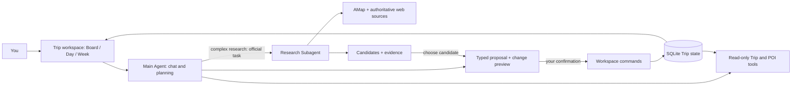

# BrandonTravel

**An AI-native travel planning workspace.**  
Plan with structure. Explore with AI. Stay in control.

[简体中文](README.zh-CN.md) · [Complete demo](docs/PORTFOLIO_DEMO.md) · [Validation evidence](docs/PORTFOLIO_EVIDENCE.md)


**Status: runnable Portfolio engineering delivery.** Three distinct Trips completed real blueprint, workspace editing, evidence-backed research, confirmation and refresh journeys. Human recommendation-quality acceptance remains **Pending**; failed attempts and limitations are preserved in the evidence report. The interface currently uses Chinese and prioritizes travel in mainland China.

## A plan you can keep improving

Travel planning is more than generating a list of attractions. BrandonTravel brings three recurring problems into one workspace:

| The problem | How the workspace helps |
|---|---|
| Turning a blank page into a coherent trip. | Start with a name, add destination, dates and companions when ready, then request a multi-day blueprint. Review changes before saving. |
| Discovering that a good-looking plan makes one day too busy. | Discuss the selected day alongside its timeline and map. Check overlaps, untimed activities and movement references; edit the same plan in Board, Day or Week. |
| Recommendations that hide their sources and tradeoffs. | Research against your preferences and existing plans. Inspect evidence and uncertainty before adding a candidate to Ideas or the itinerary. |

You can plan manually throughout. An **Idea** is a possibility; an **Activity** is an arrangement on a particular day. Activities can remain untimed. Neither means anything has been booked.

## From a blank trip to an editable journey

1. **Start small.** Create a Trip with just a name and collect Ideas. Unknown destination, dates and companions stay unknown.
2. **Build a first draft together.** Fill in Where / When / Who and preferences. Generate an AI blueprint, inspect its change preview and assumptions, then confirm the proposal.
3. **Make it yours.** Move and edit activities in Board, Day or Week. All three views use the same persisted Trip state.
4. **Discuss today in context.** Open Day to see conversation, timeline and map together. Request a selected-day adjustment and review its proposed additions, edits or removals.
5. **Explore with evidence.** Ask a focused research question. Review candidates, preference fit, tradeoffs, source excerpts and unknowns. Save a candidate to Ideas or choose a day through another change preview.
6. **Continue where you left off.** Refresh to restore itinerary, conversation, research records and proposal status. Stale proposals cannot overwrite newer manual edits.

**AI proposes. You confirm. The Workspace saves.** Adopting a recommendation is the beginning of an editable plan: adapt it as your trip takes shape.

Actual short demos: [AI blueprint](docs/demos/blueprint.webm) · [Daily planning](docs/demos/day-planning.webm) · [Research → adoption](docs/demos/research-adoption.webm). The [demo guide](docs/PORTFOLIO_DEMO.md) provides current runnable steps and clearly labeled example personas.

## How it works



Python **Deep Agents / LangChain** provide the agent loop, delegation, structured output and middleware. Main Chat uses Qwen; explicit blueprint/day planning and research default to DeepSeek Flash. The Agent has no itinerary-write tool. Confirmation checks the latest Trip context and applies the proposal atomically. LangSmith records execution for inspection.

**Adopt > Adapt:** use official APIs and mature components before adding custom machinery. React/Vite, Kibo UI Kanban and the integrated Full Calendar components power the UI; FastAPI and SQLite keep the application local and small. There is no custom agent harness, vector database or microservice network. See [dependencies and licenses](docs/DEPENDENCIES.md) and the [implementation learning guide](docs/agent-learning/portfolio-guide.md).

## Run locally

Requirements: **Python 3.11+, uv and Node.js 22+**. Run these Windows PowerShell commands from the repository root:

```powershell
uv sync --frozen
npm ci --prefix apps/web
if (-not (Test-Path .env)) { Copy-Item .env.example .env }
```

Fill the ignored `.env` file before using live AI and sources:

| Key | Used for |
|---|---|
| `DASHSCOPE_API_KEY` | Main Chat with `AGENT_MODEL=qwen3.8-flash`; DashScope region must match `AGENT_BASE_URL`. |
| `DEEPSEEK_API_KEY` | Blueprint, day proposals and research with `PORTFOLIO_MODEL=deepseek-flash`. |
| `AMAP_WEB_SERVICE_KEY` | Server-side POI search, map imagery and available route references. |
| `TAVILY_API_KEY` | Research web search and page extraction. |
| `LANGSMITH_API_KEY` | Execution tracing; also set `LANGSMITH_PROJECT` and, if needed, workspace ID. |

Use the profile/model IDs in [.env.example](.env.example) unless intentionally changing the supported configuration. Anthropic and other comparison profiles are optional experimental references, **not required to run the product**. Missing providers produce explicit errors, not a silent fixture fallback. Restart the API after configuration changes. The [configuration guide](docs/CONFIGURATION.md) covers original Chat setup; the [Portfolio demo guide](docs/PORTFOLIO_DEMO.md) covers additional providers.

```powershell
powershell -File scripts/dev.ps1
```

Open **http://127.0.0.1:5173/**. API documentation: **http://127.0.0.1:8000/docs**. Ctrl+C stops development services. The default database is `data/brandontravel.sqlite3`; restarting does not erase your work.

Alternatively, use two terminals:

```powershell
.venv\Scripts\python -m uvicorn apps.api.main:app --host 127.0.0.1 --port 8000
npm run dev --prefix apps/web -- --port 5173 --strictPort
```

## Real services, fixtures and validation

- **Application paths:** persisted Trips, synchronized views, proposal previews and confirmation, stored research lifecycle, configured model/source integrations. Implementation alone does not establish research quality; consult the actual [Portfolio evidence](docs/PORTFOLIO_EVIDENCE.md).
- **Explicit fixtures:** `?demo=1` is a read-only UI fixture. Sample trips and test personas are synthetic inputs, not bookings. Chat demo mode and mocked browser/API tests do not prove live research or create a verified provider trace.
- **Real-service runs:** use configured accounts and consume quotas. Failed or empty research is reported as such. A `partial` result requires inspecting its limitations; it is not complete verification.

```powershell
.venv\Scripts\python -m pytest -q
npm run build --prefix apps/web
# With development services running and Chrome installed:
apps\web\node_modules\.bin\playwright.cmd test --config playwright.config.mjs
```

The [evidence report](docs/PORTFOLIO_EVIDENCE.md) records actual commands, outcomes, browser captures, real runs and trace verification. Deterministic checks cover persistence, state consistency, scope, stale/duplicate confirmation, permissions and contracts. Recommendation quality requires human assessment: unreviewed samples remain **Pending**, never presented as human scores from AI evaluation. [Acceptance criteria](docs/ACCEPTANCE.md) and independent [Workspace](docs/agent-learning/review-portfolio-workspace.md), [Agent](docs/agent-learning/review-portfolio-agent.md) and [integration](docs/agent-learning/review-portfolio-integration.md) reviews remain quality gates.

## Current boundaries

This is a **local, single-user application**, without production authentication, collaboration, booking or payment. Keep it on loopback. API keys stay server-side and `.env` is ignored. Portfolio traces can contain scrubbed Trip context, questions and source excerpts; this is not a promise that no travel content leaves your computer.

Research uses AMap and a bounded set of official/authoritative public web sources. Xiaohongshu/community collection is deferred. A citation establishes provenance, not the truth of every generated claim. Opening times, future availability, accessibility and reservations may still need checking.

The daily map uses server-fetched AMap static imagery, up to ten markers, selection and zoom controls; it is not live navigation. Straight-line estimates and provider driving references are labeled separately. Untimed activities remain visible; missing coordinates stay missing. Activity times use the Trip timezone; cross-midnight events are unsupported and ambiguous/nonexistent DST times are rejected.

## Explore the engineering evidence

[Portfolio roadmap](docs/PORTFOLIO_1_ROADMAP.md) · [Contracts](docs/PORTFOLIO_CONTRACTS.md) · [Learning guide](docs/agent-learning/portfolio-guide.md) · [R1/R2 plan](PLAN.md) · [Runtime experiments](docs/agent-learning/runtime-report.md) · [Model comparison](docs/agent-learning/model-comparison.md) · [Human review](docs/agent-learning/human-review.md) · [First-round validation](docs/VALIDATION.md)

Built in [Yiping-Nash/BrandonTravel](https://github.com/Yiping-Nash/BrandonTravel). V2 uses `v2/rebuild` and preserves V1 history under `archive/v1-before-v2-20261026`. R1/R2 records remain engineering evidence, not rewritten claims of product acceptance. Mindtrip informed interaction references; its brand, images and proprietary code are not copied.

