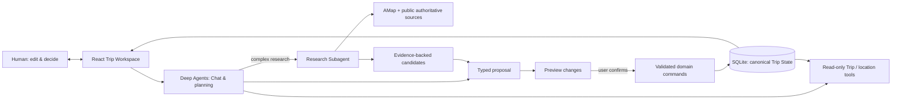

# BrandonTravel

### An AI-native travel planning workspace

**Plan with structure. Explore with AI. Stay in control.**

[简体中文](README.zh-CN.md) · [Watch the demos](docs/PORTFOLIO_DEMO.md) · [Architecture & evaluation](docs/agent-learning/portfolio-guide.md)


> **A travel plan isn't a one-shot AI answer.** It's a living plan that changes as you discover places, rethink a day, and make decisions. BrandonTravel gives that plan a structured home — with an AI assistant that works *with* the workspace, not instead of it.

## Three moments, one trip

### 01 · Go from an idea to a plan you can edit

Start with a destination — or just a trip name. Add **where, when and who** when you're ready. Ask Brandon for a multi-day blueprint, review exactly what it proposes to add or change, then make the plan your own in a drag-and-drop Board.


[Download the full blueprint recording (WebM)](docs/demos/blueprint.webm)

### 02 · Make each day workable, not just impressive on paper

Open a day to see **conversation, timeline and map together**. Move activities, adjust time windows, inspect location and travel references, and ask Brandon to suggest changes for *this* day. Time overlaps and missing information stay visible instead of being guessed away.


[Download the full day-planning recording (WebM)](docs/demos/day-planning.webm)

### 03 · Explore new options with evidence, not just confident prose

Ask a focused question based on your interests and existing itinerary. A dedicated Research Agent uses place data and public sources to propose candidates with **reasons, evidence, trade-offs and unknowns**. Review a candidate, send it to Ideas or a chosen day, and keep editing.


[Download the full research recording (WebM)](docs/demos/research-adoption.webm)

## Built around one source of truth

The conversation is not the itinerary. **Trip State** is.



- **Human in control.** Both manual edits and AI proposals ultimately use validated workspace commands. The Agent cannot directly write an itinerary.
- **Context-aware, not chat-dependent.** The Agent reads the current Trip and selected day, rather than treating old conversation as authoritative state.
- **Evidence is a separate object.** Source IDs, retrieval times, claims and limitations are retained; a citation is provenance, not automatic proof.
- **Use the framework, not a homemade agent loop.** Built with Python **Deep Agents / LangChain**, official task delegation and middleware; **LangSmith** supports trace inspection.

## A real engineering prototype — with explicit limits

The current release is a **local, single-user portfolio prototype**, not a production booking service. Three distinct example trips — **Shanxi (heritage), Hangzhou (family), Shanghai (older travellers)** — completed real browser flows covering blueprint, editing, source-backed research, confirmation and refresh. The latest deterministic/Fake-model regression suite reports **332 passing tests**. See the [evidence report](docs/PORTFOLIO_EVIDENCE.md) for actual runs, failures and traces.

**What this does not prove:** research quality has **not** received final human sign-off. The recorded research examples are partial and highlight unresolved opening, booking or accessibility information. Research currently covers AMap and selected authoritative public sources, **not Xiaohongshu/community reviews**. The map provides static AMap imagery and route references, not turn-by-turn navigation. There is no production authentication, collaboration, reservation or payment workflow.

## Technology & reuse

| Layer | Implementation |
|---|---|
| Product UI | React · TypeScript · Vite · Kibo UI Kanban · adapted Full Calendar |
| Domain/API | Python · FastAPI · SQLite · versioned Trip commands & validation |
| Agents | Deep Agents · LangChain · Qwen (chat) · DeepSeek Flash (blueprint/day/research) |
| Research | AMap place services · Tavily / accessible public sources · typed Evidence |
| Observability | LangSmith traces · contract, browser and scenario tests |

**Adopt → Adapt → Build:** reusing open-source interaction components and official agent patterns was a deliberate product-engineering choice. [Dependencies & licenses](docs/DEPENDENCIES.md) · [Technical walkthrough](docs/agent-learning/portfolio-guide.md)

## Try it locally

Requires **Python 3.11+, uv and Node.js 22.12+** (validated on Python 3.13 and Node.js 24). From the repository root on Windows PowerShell:

```powershell
uv sync --frozen
npm ci --prefix apps/web
if (-not (Test-Path .env)) { Copy-Item .env.example .env }
# Fill server-side keys in .env; see docs/PORTFOLIO_DEMO.md
powershell -File scripts/dev.ps1
```

Open **http://127.0.0.1:5173/**. Live features require the configured model, AMap and Tavily API keys; the app does **not** silently substitute a successful fixture when a provider fails. See [.env.example](.env.example) and the [step-by-step demo](docs/PORTFOLIO_DEMO.md). `?demo=1` is an explicitly read-only UI fixture, not a real Agent run.

## For builders & reviewers

[Product and acceptance scope](docs/PORTFOLIO_1_ROADMAP.md) · [Agent implementation guide](docs/agent-learning/portfolio-guide.md) · [Live traces & test evidence](docs/PORTFOLIO_EVIDENCE.md) · [Known limits & human review](docs/agent-learning/human-review.md)

*An independent AI-native product-building project. Product references informed interaction patterns; their proprietary assets and code were not copied. Previous V1 history is preserved in this repository.*

**License:** V2 original code is [MIT](LICENSE). Third-party notices and the separate licensing of archived V1 code are explained in [NOTICE.md](NOTICE.md).
