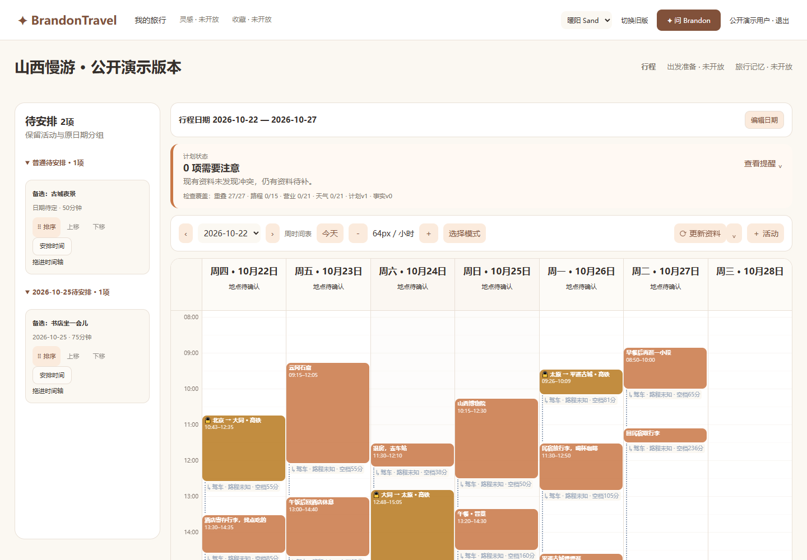
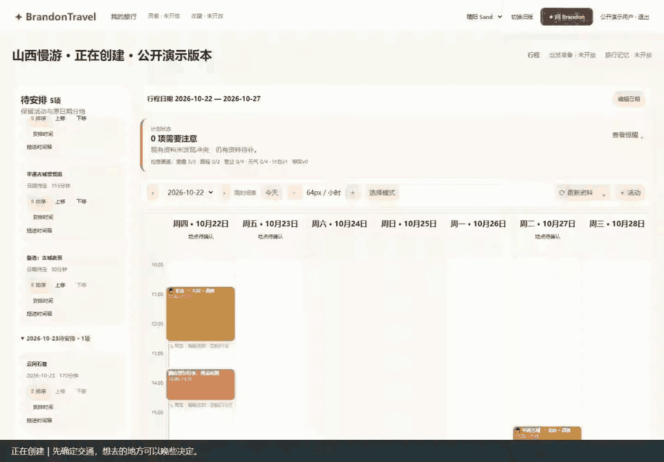
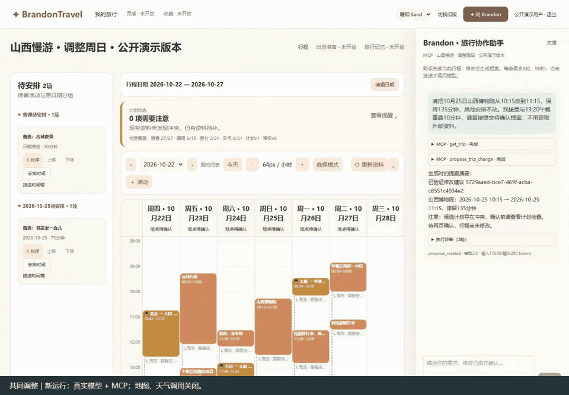
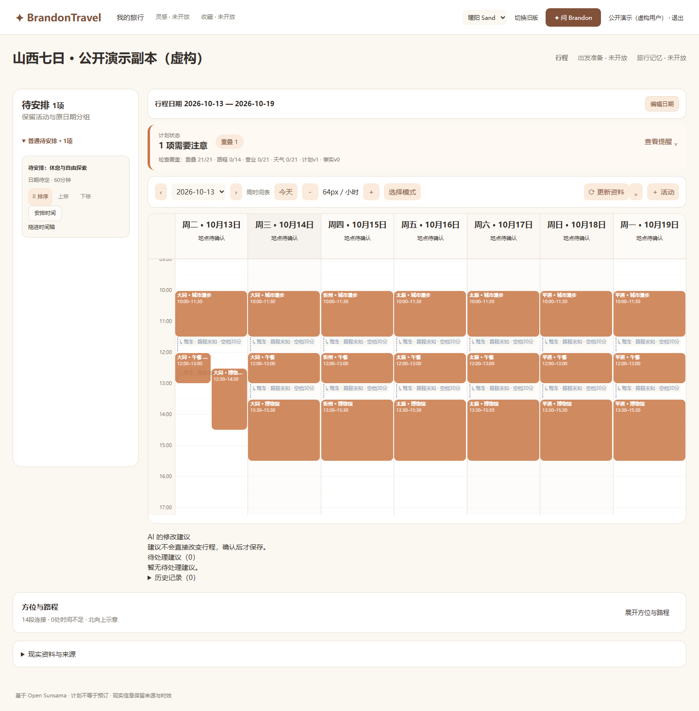
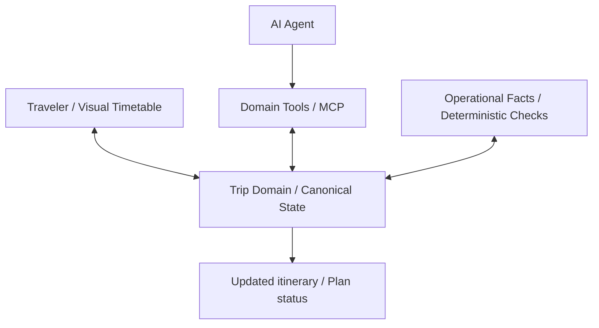

<div align="center">

# BrandonTravel

### Plan together. Travel your way.

**旅行计划会变，Brandon 帮你一起应对变化。**

一个正在开发中的 AI-native 旅行规划工作台：把路线、时间与想去的地方放进一份随时能调整的行程；让 AI 在理解当前计划的基础上提出修改，而不是每次重新生成一份攻略。

[**English**](README.en.md) · [**了解产品 ↓**](#一次旅行为什么需要一个能共同编辑的计划) · [**观看演示 ↓**](#看看-brandontravel-如何工作) · [**产品设计 ↓**](#产品背后的三个设计选择) · [**运行项目 ↓**](#本地运行)

<sub>Independent project · AI Product Design × Agent Engineering · Active MVP</sub>

</div>




> **目前的产品状态**：可视化时间表、人工编辑与多种计划检查已经实现；AI 读取行程、提出修改、用户确认及写入读回已有真实验证，但仍处于稳定性迭代中。主动信息发现、跨来源建议和全程陪伴是正在探索的产品愿景，并非现有完整能力。

## 一次旅行，为什么需要一个能共同编辑的计划？

BrandonTravel 来自一次和朋友 Brandon 的山西旅行。

出发前，我们会查景点、翻攻略、估算路程，努力排出一份看起来合理的计划。但真正开始规划后会发现：**困难往往不在于生成第一版行程，而在于不断处理变化。**

想去的地方越来越多，时间却有限；突然决定多留半天，原来的安排要重新分配；两个景点看着很近，实际路上却要花不少时间。更麻烦的是：当计划交给聊天式 AI 反复修改时，哪些活动被保留、哪些被移动、当前最终版本是什么，可能变得不够清楚。

**我想做的不是另一款一次性生成攻略的聊天机器人。**

我希望 BrandonTravel 最终成为一个懂得当前行程、能主动搜集信息、持续发现变化，并和旅行者一起做决策的伙伴。它可以帮你规划，但计划始终属于你。

## 看看 BrandonTravel 如何工作

目前先从三个能被看到、被操作、被验证的环节开始。

### 01 / 先把旅行安排得清清楚楚

你可以直接在时间表上增删、拖动和调整活动，把还没决定的景点放进「待安排」区。即使缩短旅行日期，被移出的活动也会保留原来的日期分组，方便之后重新安排。




**这一步不需要 AI。** 旅行计划首先应该是一个人自己就能掌控的工具。

### 02 / 计划变了，让 AI 和你一起调整

> “把周日的山西博物院从 10:15 改到 11:15，时长不变，其他安排不动。我接受与午餐重叠 10 分钟。”

理想的体验不是让 AI 再发来一大段新版攻略，而是让它先读懂**已经存在的行程**，针对具体活动提出可审阅的修改。用户确认后，修改才写入共享的行程状态，时间表随之更新；系统再读取保存的结果，核对实际发生了什么。




<sub>Agent 协作仍在实验与稳定性优化中；这里展示经过验证的典型路径，不代表任意复杂要求都能稳定完成。[查看本次运行证据](demo/v2/evidence/summary.json) · [评估与限制](docs/evaluation.md)</sub>

### 03 / 一个好的计划，还要经得起现实检查

好看的日程不一定能走得通。BrandonTravel 将活动重叠、交通时间不足、营业时间以及户外天气相关检查，放进独立于 AI 的领域能力中。已知事实展示来源与有效期；不能确认的内容保持未知，而不是让模型替事实做保证。



这意味着：**AI 可以帮你思考怎样安排，但不是所有正确性判断都应该交给 AI 猜。**

## 产品真正想走向哪里？

<div align="center">

### From a travel planner to a travel companion.

**从「你问我答」走向「我理解你的行程，也知道何时值得提醒你」。**

</div>

目前打下的基础是**一份可由人和 AI 共同维护的结构化行程**。在这之上，我希望逐步探索下面的体验：

| 未来体验 | 用户会得到什么 | 状态 |
| --- | --- | --- |
| **主动发现变化** | 天气、交通或开放条件发生变化时，及时指出可能受影响的安排 | Product Vision |
| **自己搜集资料，给出有依据的建议** | 结合官方信息、地图、旅行者经验等多方来源，说明推荐理由与不确定性 | Product Vision |
| **照顾重要节点** | 对需要预约、换乘或准时到达的事项，提前提示需要检查的内容 | Product Vision |
| **逐渐理解旅行偏好** | 记住你对节奏、交通、景点和自由时间的选择，并允许随时更改 | Product Vision |
| **持续共同规划** | 不是生成一次就结束，而是在旅行前和途中不断更新同一份计划 | 正在分阶段验证 |

> **愿景说明**：上表描述未来产品方向，不表示自动监控、订票核验、偏好记忆或跨平台证据聚合已经可靠上线。后续概念界面将以 **Concept** 明确标注。

## 产品背后的三个设计选择

### 让行程成为计划的权威状态，而不是聊天记录

结构化 Timetable 是当前行程的权威状态（Canonical Trip State）。无论用户直接拖动，还是 Agent 通过工具修改，都围绕同一份计划展开。聊天帮助表达意图，但不能代替实际保存的行程。

### 能用确定性能力解决的，不让模型猜

活动编辑、日期处理、交通 Transition、冲突检查等先成为可独立工作的 Domain Capability，再通过 API / MCP 提供给 Agent。模型主要负责理解需求和提出方案；规则和状态校验仍由软件系统处理。

### 从可演示转向可验证

开发过程中建立了固定场景回归，并进行了 SDK 隔离兼容性实验；独立泛化验证尚未完成。成功的调用链需要能检查工具执行和写入后状态；失败案例同样值得记录，而不是只展示一次漂亮回答。



[产品复盘与关键取舍](docs/product-case-study.md) · [架构说明](docs/architecture-overview.md) · [评测与限制](docs/evaluation.md)

## 当前进度与演示边界

| 范围 | 当前情况 |
| --- | --- |
| 可视化时间表、人工编辑、待安排区、日期调整 | **Built**；部分设备及完整用户流程仍待进一步验收 |
| 交通 Transition、Plan Status 与确定性检查 | **Built**；外部数据依赖来源、时效与配置，未知情况保留 UNKNOWN |
| Agent 读取 → 提案 → 用户确认 → 写入 → 读回 | **Experimental**；有真实千问 + MCP 历史记录，当前复杂场景仍可能失败 |
| 自主资料搜集、持续监测、证据综合、偏好记忆 | **Vision / Planned**，不作为已交付功能宣传 |

**演示真实性说明**：上面的 GIF 均由本次真实页面录屏转制。人工编辑通过真实网页保存；AI 片段使用新运行的真实模型＋MCP，确认由脚本点击真实网页完成，再通过正式 API 读回。不是静态模拟，也不是完整真人用户验收。

[正在创建 · 12 秒原视频](demo/v2/01-creating.webm) · [成形行程 · 13 秒原视频](demo/v2/02-formed.webm) · [真实 AI 协作 · 24 秒原视频](demo/v2/03-collaborating.webm) · [Trace、State Diff 与全部尝试](demo/v2/evidence/summary.json)

本轮累计 6 次模型请求、地图／天气调用 0。首次触发上下文限制；第二次模型成功但录制脚本结尾断言错误；第三次在新副本完成提案、确认及读回。失败记录保留，不由这些样本推出整体成功率。

原视频约 4–6fps、无音轨，GIF 为约 4fps 节选；尚未合成 70 秒成片。历史 [131 秒 UI 录屏](demo/portfolio-demo.webm) 的提案由确定性 API 构造，无模型调用；[S01-1 历史证据](demo/agent-evidence.json) 为另一条独立测试，不能混为同一次运行。

目前没有公网托管或匿名真实模型体验入口；简易地图可用，高德真实 JS 底图仍需凭据环境核实。山西公开演示版本已在隔离实例导入、读回并录制；交通时间为展示设定，未核验、未预订。

## 本地运行

当前主要面向 Windows 开发环境，需要 Node.js 24。首次执行会下载项目内 Bun、PostgreSQL 及依赖，不安装系统服务：

```powershell
powershell -NoProfile -ExecutionPolicy Bypass -File scripts/setup-local.ps1
powershell -NoProfile -ExecutionPolicy Bypass -File scripts/local-db.ps1 init
powershell -NoProfile -ExecutionPolicy Bypass -File scripts/local-db.ps1 start
$env:TRAVEL_FACTS_ALLOW_NETWORK='false'
node scripts/local-start.mjs
```

打开 <http://localhost:4331/> 并注册。最后一条命令同时启动前后端；`Ctrl+C` 停止前后端，但数据库仍会运行。后续通常只需启动数据库并运行 `local-start`。默认使用端口 `54329 / 4332 / 4331`。

无需模型 Key 也能编辑行程并查看已有检查。`TRAVEL_FACTS_ALLOW_NETWORK=false` 只关闭外部事实采集，**不自动关闭已配置的聊天模型调用**；离线展示时不要发送聊天请求。凭据应保存在 Git 忽略的 `.runtime` 中，详见 [演示指南](docs/demo-guide.md)。全新机器部署尚未经过独立验证，不保证一键安装成功。

## 项目文档

- [产品案例：问题、MVP 与设计取舍](docs/product-case-study.md)
- [系统架构与能力边界](docs/architecture-overview.md)
- [Agent 评测、证据及失败限制](docs/evaluation.md)
- [演示使用指南](docs/demo-guide.md)
- [本次公开演示：真实模型、Trace 与状态读回](demo/v2/evidence/summary.json)
- [完整已应用提案与前后状态](demo/v2/evidence/applied-run.json)
- [历史真实 Agent 调用证据](demo/agent-evidence.json)

## 开源与许可

BrandonTravel 是个人独立开发中的**公开源码、非商业原型**。项目基于固定版本的 Open Sunsama 进行开发，保留上游许可证及归属要求；**不宣称采用 MIT / Apache 等可自由商用许可**。请在使用或复用前阅读仓库的 `LICENSE`、`UPSTREAM.md` 与 credits。

---

<div align="center">

**BrandonTravel** · Built around one idea:

*AI should help you make better travel decisions, without taking your plans out of your hands.*

</div>
