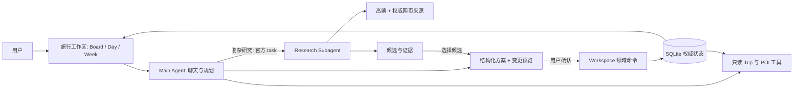

# BrandonTravel

**AI 原生旅行规划工作区。**  
有条理地安排，用 AI 探索，把决定权留给自己。

[English](README.md) · [完整体验路径](docs/PORTFOLIO_DEMO.md) · [验证证据](docs/PORTFOLIO_EVIDENCE.md)


**当前状态：可运行的 Portfolio 工程交付版。** 三类旅行均已完成真实蓝图、工作台编辑、研究、确认采纳与刷新路径。真人推荐质量评审仍为 **Pending**；失败尝试和已知限制保留在证据报告中。当前界面为中文，优先面向中国大陆旅行。

## 一份可以不断完善的旅行计划

旅行准备不止是生成一张景点清单。BrandonTravel 将三个常见问题放进同一个工作区：

| 你遇到的问题 | 工作区如何帮助 |
|---|---|
| 从空白开始，很难形成连贯的多日安排。 | 先创建一个名字，再逐步填写目的地、日期和同行人，让 AI 提出旅行蓝图，审阅变更后再保存。 |
| 整体计划看起来不错，实际某一天却太赶。 | 把当天聊天、时间轴和地图放在一起，查看重叠、未定时间与移动参考，在 Board / Day / Week 中调整同一份计划。 |
| 推荐听起来很可信，却看不到来源和取舍。 | 结合偏好与已有活动研究候选，先看证据、未知项和取舍，再决定保存到 Ideas 还是加入日程。 |

你始终可以手动规划。**Idea 是候选想法，Activity 是某一天的安排。** 活动可以暂不确定具体时间；安排了，也不等于已经预约。

## 从空白旅行到持续可编辑的行程

1. **先记下想法。** 只填名称就能创建 Trip、收集 Ideas。未知目的地、日期和同行人不会被系统擅自补全。
2. **共同完成初稿。** 补充 Where / When / Who 与偏好，生成 AI 旅行蓝图。查看新增、修改、删除和假设，再确认这份方案。
3. **调整成自己的计划。** 在 Board 拖动卡片，在 Day / Week 编辑活动。三个视图共用一份持久化的 Trip 状态。
4. **围绕当天讨论。** 进入 Day，同时查看聊天、时间轴和地图。生成针对选中日期的调整方案，先预览再应用。
5. **带着证据探索。** 提出具体研究问题，查看候选、偏好匹配、取舍、来源摘录与未知项。将候选保存到 Ideas 或加入指定日期，同样经过变更预览。
6. **随时回来继续。** 刷新后恢复行程、聊天、研究记录和方案状态。手动编辑让旧方案过期时，旧方案不能覆盖新安排。

**AI 提议，你来确认，Workspace 负责保存。** 采纳推荐只是起点，之后仍能按照你的节奏继续调整。

真实短演示：[AI 旅行蓝图](docs/demos/blueprint.webm) · [每日规划](docs/demos/day-planning.webm) · [研究与采纳](docs/demos/research-adoption.webm)。可运行步骤与明确标注的演示人物见[完整 Demo 指南](docs/PORTFOLIO_DEMO.md)。

## 如何实现



Python **Deep Agents / LangChain** 提供 Agent 执行、委派、结构化输出和中间件。普通 Main Chat 使用 Qwen；显式蓝图、每日规划和深入研究默认使用 DeepSeek Flash。Agent 没有直接修改日程的工具。确认时检查最新 Trip 上下文，并原子应用方案；LangSmith 记录执行过程供核查。

**Adopt > Adapt：先复用，再做必要适配。** 优先使用官方框架 API 与成熟组件。前端采用 React/Vite、Kibo UI Kanban 和已集成的 Full Calendar 组件；FastAPI 与 SQLite 构成轻量本地应用。没有自制 Agent Harness、向量数据库或微服务网络。版本、来源与许可见[依赖记录](docs/DEPENDENCIES.md)及[实现学习指南](docs/agent-learning/portfolio-guide.md)。

## 本地运行

需要 **Python 3.11+、uv、Node.js 22+**。以下命令在仓库根目录的 Windows PowerShell 中执行：

```powershell
uv sync --frozen
npm ci --prefix apps/web
if (-not (Test-Path .env)) { Copy-Item .env.example .env }
```

使用真实 AI 与来源前，在被 Git 忽略的 `.env` 中填写：

| Key | 用途 |
|---|---|
| `DASHSCOPE_API_KEY` | Main Chat，默认 `AGENT_MODEL=qwen3.8-flash`；百炼 Key 地域须匹配 `AGENT_BASE_URL`。 |
| `DEEPSEEK_API_KEY` | 旅行蓝图、当天调整与研究，默认 `PORTFOLIO_MODEL=deepseek-flash`。 |
| `AMAP_WEB_SERVICE_KEY` | 服务端地点搜索、地图图片与可用的路线参考。 |
| `TAVILY_API_KEY` | 深入研究的网页搜索和正文提取。 |
| `LANGSMITH_API_KEY` | 执行追踪；同时设置 `LANGSMITH_PROJECT`，有需要时填写 workspace ID。 |

按 [.env.example](.env.example) 保留 profile 与模型 ID，除非明确切换受支持的配置。Anthropic 等对照模型属于可选实验参考，**不是运行产品的必需项**。缺少服务配置会明确报错，不会悄悄切换成固定数据。修改配置后重启 API。[配置指南](docs/CONFIGURATION.md)介绍原有 Chat 配置，[Portfolio Demo 指南](docs/PORTFOLIO_DEMO.md)补充新服务配置。

```powershell
powershell -File scripts/dev.ps1
```

打开 **http://127.0.0.1:5173/**；API 文档在 **http://127.0.0.1:8000/docs**。Ctrl+C 停止开发服务。默认数据库为 `data/brandontravel.sqlite3`，重启不会清空旅行。

也可以分别在两个终端启动：

```powershell
.venv\Scripts\python -m uvicorn apps.api.main:app --host 127.0.0.1 --port 8000
npm run dev --prefix apps/web -- --port 5173 --strictPort
```

## 哪些是真实功能，哪些是固定数据？

- **应用实现：** Trip、Ideas 与活动持久化，三视图同步，方案预览与确认，研究生命周期和记录恢复，以及配置后的模型、来源接入。实现存在不代表推荐质量已达标，应查看实际[产品验证证据](docs/PORTFOLIO_EVIDENCE.md)。
- **明确标注的 fixture：** `?demo=1` 是只读 UI 固定数据。示例旅行与测试人物不是实际出行或预订；Chat 演示模式、模拟浏览器/API 测试不证明真实研究质量，也不会提供虚假的真实服务 Trace。
- **真实服务运行：** 使用你配置的平台账号并消耗额度。失败和无结果如实呈现；`partial` 需要阅读具体局限，不表示所有信息都已核实。

```powershell
.venv\Scripts\python -m pytest -q
npm run build --prefix apps/web
# 先运行开发服务，并安装 Chrome：
apps\web\node_modules\.bin\playwright.cmd test --config playwright.config.mjs
```

[验证报告](docs/PORTFOLIO_EVIDENCE.md)记录实际命令、结果、浏览器截图、真实调用与 Trace 核验。确定性检查覆盖状态一致性、持久化、跨 Trip、过期/重复确认、权限及契约。推荐质量由真人评审；尚未审阅的样本标记 **Pending**，不会把 AI 评分当作人工评分。[验收标准](docs/ACCEPTANCE.md)以及独立的 [Workspace](docs/agent-learning/review-portfolio-workspace.md)、[Agent](docs/agent-learning/review-portfolio-agent.md)、[最终集成](docs/agent-learning/review-portfolio-integration.md)审查持续作为质量门槛。

## 当前边界

当前是**本地单用户应用**，没有生产认证、多人协作、预订或支付，应只监听 loopback。API Key 留在服务端，`.env` 不提交 Git。Portfolio Trace 可能包含脱敏后的 Trip 上下文、问题及来源摘录；不能理解为旅行内容完全不会离开本机。

研究当前使用高德，以及限定范围的官方机构和权威公开网页。小红书/社区采集暂缓。引用证明内容来源，不自动证明生成的每句话都正确。开放时间、未来可用性、无障碍与预约要求可能仍需另行确认。

每日地图使用服务端获取的高德静态地图，支持最多十个标记、地点选择和缩放，不是实时导航。直线估算与服务商驾车参考分别标注。未定时间活动仍然可见，无坐标地点不会伪造坐标。活动时间按 Trip 时区解释；不支持跨午夜事件，拒绝夏令时歧义或不存在的时间。

## 继续了解

[产品路线图](docs/PORTFOLIO_1_ROADMAP.md) · [共享契约](docs/PORTFOLIO_CONTRACTS.md) · [学习指南](docs/agent-learning/portfolio-guide.md) · [R1/R2 计划](PLAN.md) · [运行实验](docs/agent-learning/runtime-report.md) · [模型对照](docs/agent-learning/model-comparison.md) · [人工评审](docs/agent-learning/human-review.md) · [首轮验收](docs/VALIDATION.md)

沿用 [Yiping-Nash/BrandonTravel](https://github.com/Yiping-Nash/BrandonTravel)。V2 使用 `v2/rebuild` 分支，保留 V1 历史与 `archive/v1-before-v2-20261026` 归档。R1/R2 资料继续作为工程证据，不改写为产品已验收的结论。Mindtrip 仅作为交互参考，未复制其品牌、图片或专有代码。

