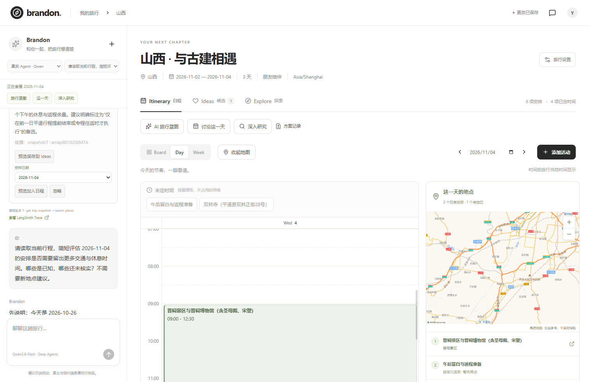
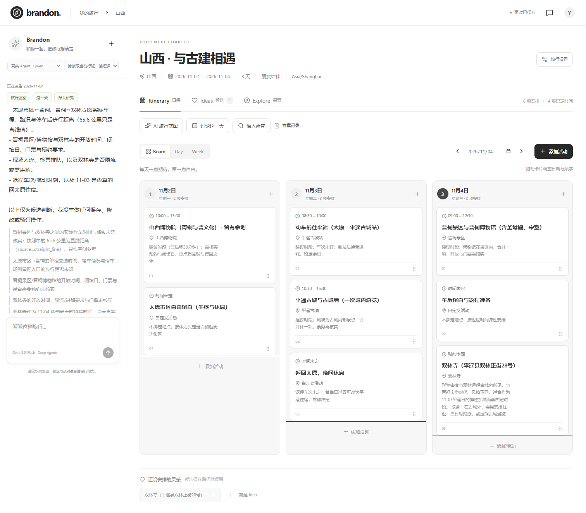
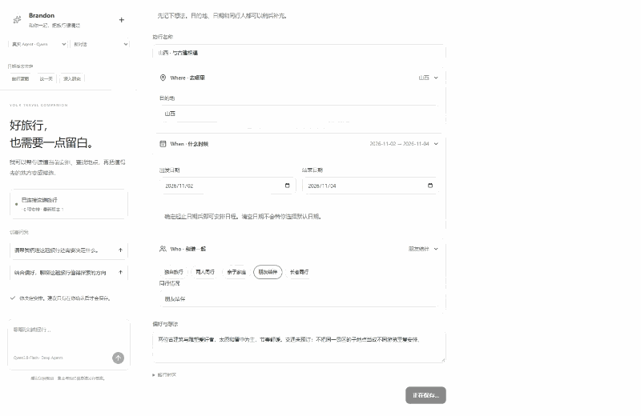
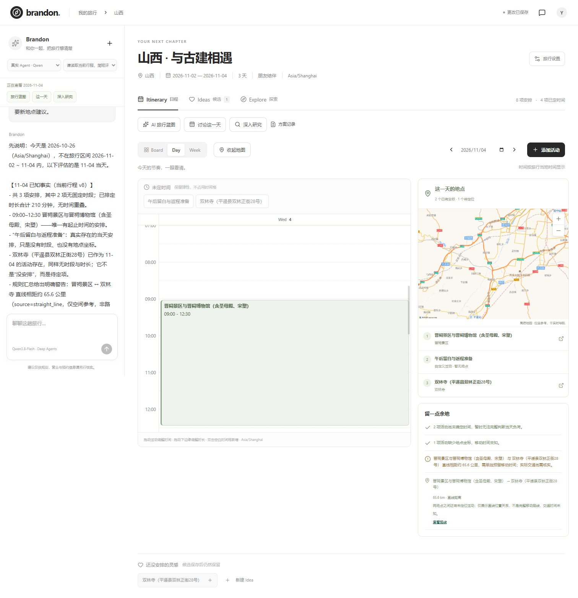
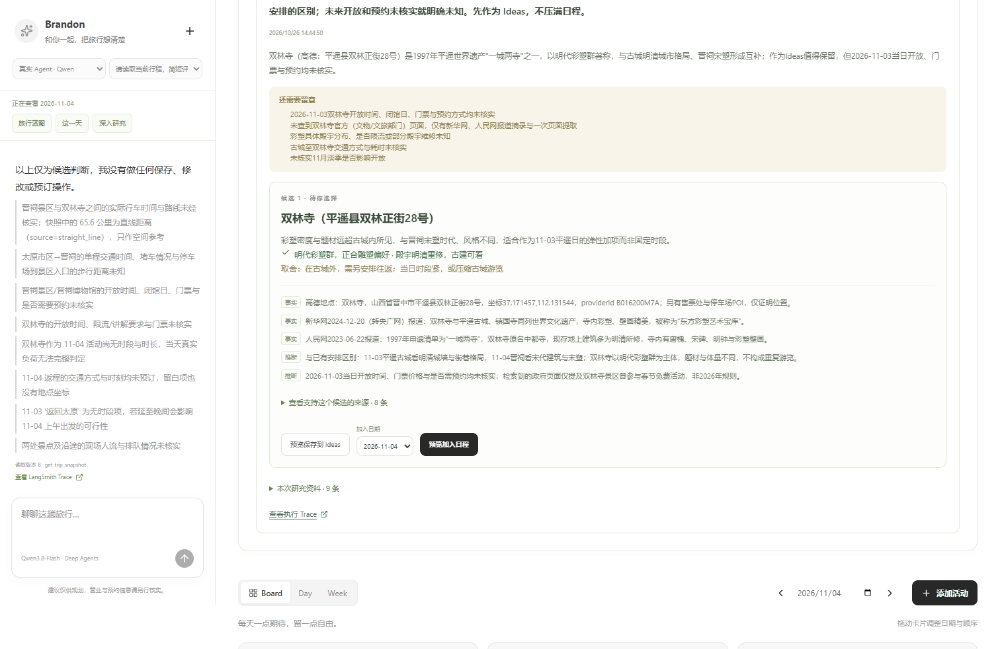
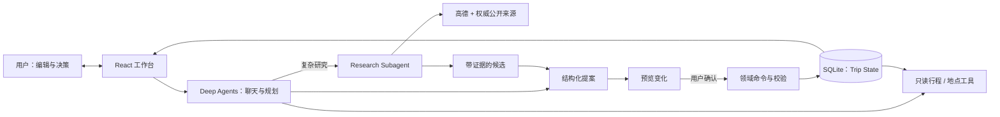

# BrandonTravel

### AI 原生旅行规划工作区

**有条理地安排，用 AI 探索，把决定权留给自己。**

[English](README.md) · [观看演示](docs/PORTFOLIO_DEMO.md) · [架构与评测](docs/agent-learning/portfolio-guide.md)



> **旅行计划不应该是一份一次生成、随后难以维护的 AI 攻略。** 它会随着新发现、偏好和现场变化不断调整。BrandonTravel 用结构化工作台承载旅行计划，让 AI 围绕真实行程协助规划与研究，而不是只在聊天里提供答案。

## 一趟旅行，三个重要时刻

### 01 · 从模糊想法到可编辑的旅行蓝图

先创建旅行，再渐进补充 **Where / When / Who**。让 Brandon 生成多日初稿，预览新增、修改与假设，确认后直接进入可拖拽的日期看板；之后也能继续手工规划。





[下载完整蓝图录屏（WebM）](docs/demos/blueprint.webm)

### 02 · 把每一天安排得真正可执行

在同一页面查看 **对话、时间轴与地图**。调整活动顺序和时间，查看地点及路程参考，也可以请 Brandon 针对所选日期提出修改方案。重叠、信息缺失等问题不会被 AI 悄悄忽略。




[下载完整单日规划录屏（WebM）](docs/demos/day-planning.webm)

### 03 · 让旅行研究有依据、有取舍

结合当前行程和偏好提出研究问题。Research Agent 检索真实地点与公开来源，输出带 **推荐理由、证据、限制与未知信息** 的候选。你可以审阅，再决定保存到 Ideas 或指定日期。




[下载完整研究录屏（WebM）](docs/demos/research-adoption.webm)

## 不是让聊天记录成为旅行计划

**Trip State 是唯一权威状态。** 对话和研究都围绕它工作。



- **用户掌握决定权：** AI 无直接写行程权限；人工修改和 AI 提案最终走相同的领域校验与提交机制。
- **始终读取当前计划：** Agent 从 Trip 和选中日期获取上下文，而不是把历史对话视为事实。
- **证据独立于结论：** 记录来源、检索时间、支持范围和不确定性；有引用不代表每句话都已证实。
- **优先复用官方框架：** Python Deep Agents / LangChain 承担 Agent 执行和委派，LangSmith 用于追踪。

## 已完成的工程闭环，以及未证明的部分

这是**本地单用户作品原型**，不是可直接预订的商业产品。已在 **山西古建筑、杭州亲子、上海长者** 三类旅行上完成真实浏览器蓝图、编辑、研究、确认和刷新恢复的演示。最新自动化回归记录 **332 项测试通过**，主要是确定性与 Fake-model 测试。[证据报告](docs/PORTFOLIO_EVIDENCE.md)保留实际调用、失败和 Trace。

**仍需人工验收推荐质量。** 现有研究样本为 partial，开放、预约、无障碍等关键信息可能未核实。当前研究覆盖高德及部分权威公开网页，**尚未接入小红书或社区评价**。地图是静态高德底图和路线参考，并非实时导航；不含生产登录、协作、订票或支付。

## 技术架构与开源复用

| 模块 | 实现 |
|---|---|
| 前端体验 | React · TypeScript · Vite · Kibo UI Kanban · 适配 Full Calendar |
| 业务与 API | Python · FastAPI · SQLite · 版本化 Trip 命令与校验 |
| Agent | Deep Agents · LangChain · Qwen 聊天 · DeepSeek Flash 蓝图/单日/研究 |
| 研究工具 | 高德地点服务 · Tavily / 公开权威网页 · 结构化 Evidence |
| 验证 | LangSmith Trace · 契约/浏览器/场景测试 |

**Adopt → Adapt → Build：** 优先复用成熟开源交互组件与官方 Agent 范式，而非自造 Harness。[依赖和许可](docs/DEPENDENCIES.md) · [Agent 代码讲解](docs/agent-learning/portfolio-guide.md)

## 本地运行

需 **Python 3.11+、uv、Node.js 22.12+**（已验证 Python 3.13 与 Node.js 24）。Windows PowerShell 在仓库根目录执行：

```powershell
uv sync --frozen
npm ci --prefix apps/web
if (-not (Test-Path .env)) { Copy-Item .env.example .env }
# 按 docs/PORTFOLIO_DEMO.md 填写 .env 服务端密钥
powershell -File scripts/dev.ps1
```

打开 **http://127.0.0.1:5173/**。真实 Agent 和来源需要配置模型、高德、Tavily 等 API Key；服务失败不会悄悄使用成功的 Fixture 替代。参见 [.env.example](.env.example) 与[完整演示步骤](docs/PORTFOLIO_DEMO.md)。`?demo=1` 是明确标注的只读 UI Fixture，不能作为真实 Agent 运行证据。

## 深入了解

[产品范围](docs/PORTFOLIO_1_ROADMAP.md) · [Agent 实现学习指南](docs/agent-learning/portfolio-guide.md) · [真实测试与 Trace](docs/PORTFOLIO_EVIDENCE.md) · [人工审阅与局限](docs/agent-learning/human-review.md)

*独立 AI-native 产品实践。Mindtrip 等产品仅用于交互参考，没有复制其专有素材或代码；仓库保留 V1 历史。*

**许可：** V2 自有代码采用 [MIT](LICENSE)。第三方署名与 V1 历史版本的独立许可边界见 [NOTICE.md](NOTICE.md)。
