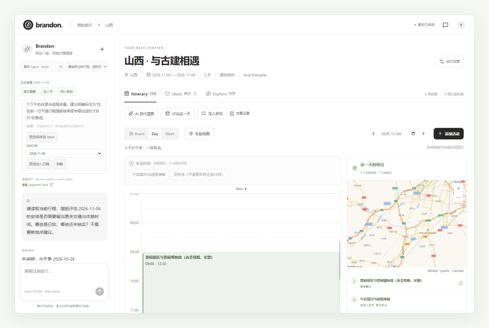
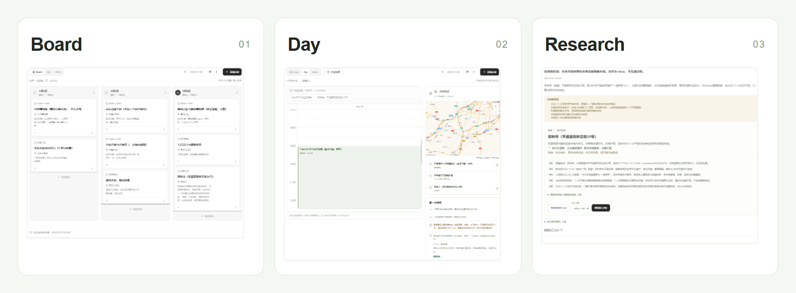
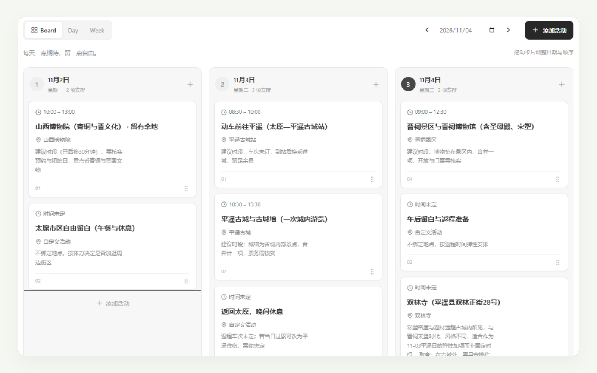
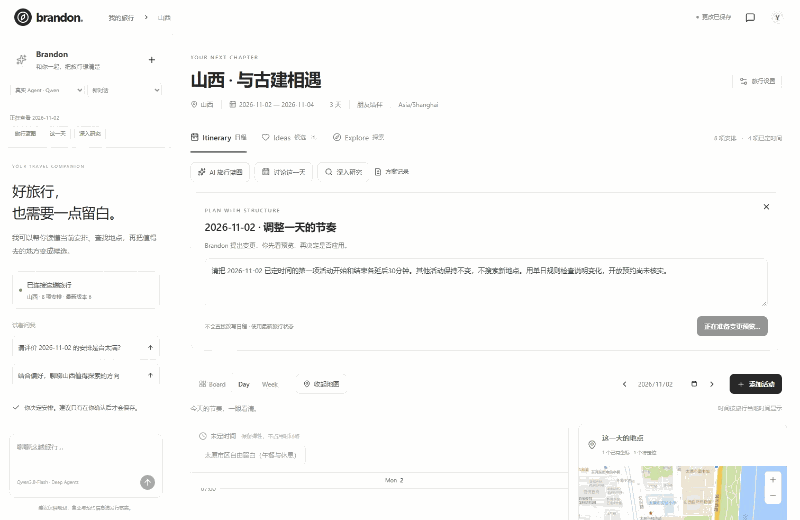
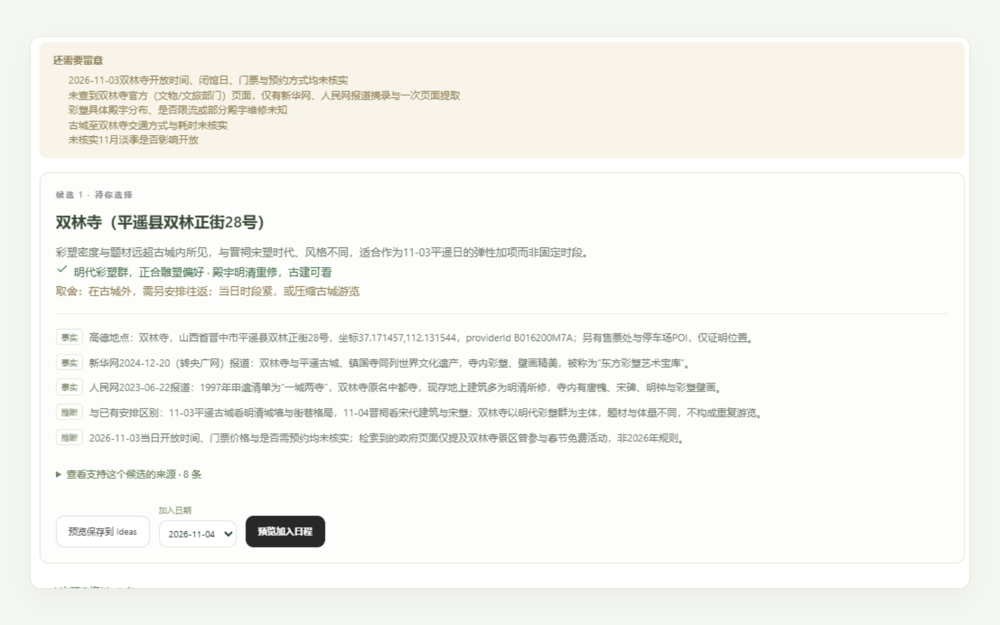
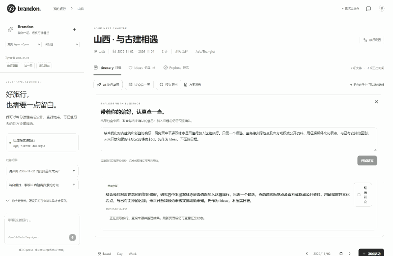
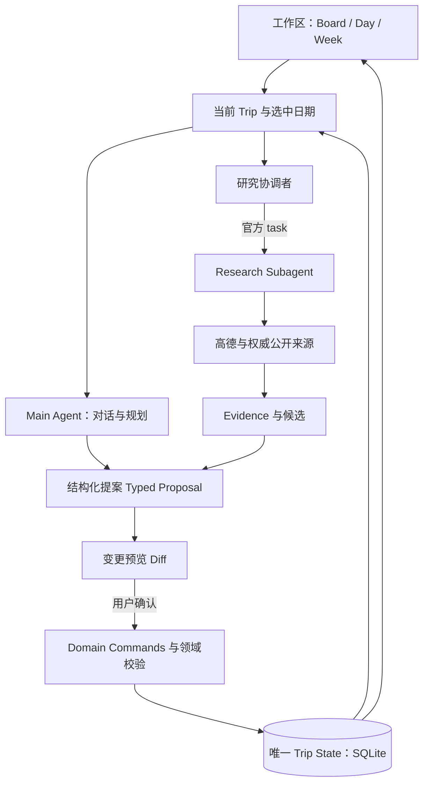

<h1 align="center">BrandonTravel</h1>

<p align="center"><strong>AI 原生旅行规划工作区</strong></p>

<p align="center"><strong>有条理地安排，用 AI 探索，把决定权留给自己。</strong></p>

<p align="center">搭建可编辑的多日蓝图，用对话、时间表和地图细化每一天，围绕当前行程研究新地点、审阅证据。哪些 AI 建议进入正式行程，由你决定。</p>

<p align="center">
  <a href="#一趟旅行三个重要时刻"><strong>▸ 观看演示</strong></a> &nbsp; · &nbsp;
  <a href="docs/agent-learning/portfolio-guide.md"><strong>技术文档</strong></a>
</p>

<p align="center">
  <a href="README.md">English</a> &nbsp; · &nbsp;
  <a href="#开始体验">开始体验</a> &nbsp; · &nbsp;
  <a href="#工作原理">工作原理</a> &nbsp; · &nbsp;
  <a href="docs/PORTFOLIO_EVIDENCE.md">工程证据</a>
</p>

<p align="center">
  <a href="docs/screenshots/portfolio/hero.png"></a>
</p>

## 为什么需要 BrandonTravel？

旅行计划总在变化：发现新的去处、想把早晨留得更松，或同行人的需求不同了。AI 攻略可以作为起点，后续仍要研究、比较和调整。

BrandonTravel 用结构化工作区承载计划。你直接编辑行程，AI 读取当前安排、探索选择，提出由你确认的修改建议。

## 一趟旅行，三个重要时刻

<p align="center">
  <a href="docs/screenshots/readme/product-overview.png"></a>
</p>

### 01 · 从模糊想法到可编辑的多日蓝图

先起名称，再逐步补充 **去哪、何时、和谁**。生成多日初稿，预览变更和假设后确认；随后跨日拖动活动，或继续手工安排。

<p align="center">
  <a href="docs/screenshots/portfolio/board.png"></a>
</p>

<p align="center">
  <a href="docs/demos/blueprint.gif">▸ 观看蓝图 → 确认 · 22 秒</a> &nbsp; · &nbsp;
  <a href="docs/demos/blueprint.webm">原始录屏</a> &nbsp; · &nbsp;
  <a href="docs/screenshots/portfolio/board.png">完整截图</a>
</p>

### 02 · 把每一天安排得更可执行

结合 **对话、时间轴与地图** 调整活动顺序和时间、查看移动参考，或请 Brandon 为选中日期提出修改方案。时间重叠和信息缺口会保留可见。

<p align="center">
  <a href="docs/demos/day-planning.gif"></a>
</p>

<p align="center">
  <a href="docs/demos/day-planning.gif">打开单日规划 GIF · 9 秒</a> &nbsp; · &nbsp;
  <a href="docs/demos/day-planning.webm">原始录屏</a> &nbsp; · &nbsp;
  <a href="docs/screenshots/portfolio/day.png">完整截图</a>
</p>

### 03 · 有依据地探索新选择

结合偏好和已有行程提出研究问题，审阅候选的 **推荐理由、来源、取舍和未知信息**，再决定保存到 Ideas 或某一天。

<p align="center">
  <a href="docs/screenshots/portfolio/research.png"></a>
</p>

<details>
<summary>▸ 观看研究 → 确认 · 38 秒</summary>

<p align="center">
  <a href="docs/demos/research-adoption.gif"></a>
</p>

<p align="center">
  <a href="docs/demos/research-adoption.webm">原始录屏</a> &nbsp; · &nbsp;
  <a href="docs/screenshots/portfolio/research.png">完整截图</a>
</p>

</details>

## 产品设计带来的不同

- **计划独立于聊天记录。** 同一份 Trip State 保存跨会话的正式行程。
- **细节由你掌控。** Board、Day、Week 可以移动、排期和修改同一组活动。
- **AI 修改先预览，再确认。** 提案展示差异，经过确认才写入行程。
- **推荐依据可以审阅。** 候选保留来源、推荐理由、限制和未知信息。
- **修改遵循统一规则。** 编辑经过领域校验，过期方案不能覆盖更新后的计划。

## 开始体验

Portfolio 1.0 提供 **真实录屏与本地单用户应用**。[演示资源](docs/demos/README.md) · [完整旅行操作路径](docs/PORTFOLIO_DEMO.md)

需 **Python 3.11+、uv、Node.js 22.12+**（已验证 Python 3.13 / Node.js 24）。在仓库根目录用 Windows PowerShell 执行：

```powershell
uv sync --frozen
npm ci --prefix apps/web
if (-not (Test-Path .env)) { Copy-Item .env.example .env }
# 按 docs/PORTFOLIO_DEMO.md 填写 .env 中的服务端密钥
powershell -File scripts/dev.ps1
```

打开 **http://127.0.0.1:5173/**。按 [.env.example](.env.example) 配置模型、高德、Tavily 和 LangSmith Key。服务失败会显示错误。`?demo=1` 是明确标注的只读 UI Fixture，与真实 AI 运行区分。

## 工作原理

**Trip State 是唯一权威行程状态。** Agent 读取当前 Trip 和相关日期上下文。Main Agent 负责对话与规划，研究协调者通过 Deep Agents 官方 `task` 委派给一个 Research Subagent。



Agent 的行程和来源工具只有读取权限。选择候选生成提案，确认时校验 Trip 归属、上下文和版本，再由领域命令提交。Evidence 记录来源和不确定性，不代表推荐质量保证。

聊天、规划和研究在同一 FastAPI 应用中有不同入口。**Deep Agents / LangChain** 承担执行、结构化输出与委派，应用层负责权限、预算和校验。[Agent 实现讲解](docs/agent-learning/portfolio-guide.md) · [确认写入代码](apps/api/db/repository.py)

## 工程实现与验证

**技术选型：** React / TypeScript / Vite；Python / FastAPI / SQLite；Deep Agents / LangChain。Qwen 负责聊天，DeepSeek Flash 负责蓝图、单日规划与研究；高德提供地点与地图，Tavily 检索公开网页，LangSmith 记录 Trace。

**Adopt → Adapt → Build：** Board 复用 Kibo UI Kanban，Day/Week 适配 [`yassir-jeraidi/full-calendar`](https://github.com/yassir-jeraidi/full-calendar)，Agent 复用官方框架和模型适配器。[版本、来源与许可](docs/DEPENDENCIES.md)

- **真实产品演示：** 山西古建、杭州亲子、上海长者三类旅行，完成从空白 Trip 到蓝图、编辑、研究采纳与刷新恢复的浏览器路径。失败记录也予以保留。
- **自动化回归：** 2026-10-26，**332 项确定性 / Fake-model 测试、5 项 Chrome 回归及生产构建通过**。这些验证契约与行为，不能代替真实推荐质量验收。[Release Review](docs/RELEASE_REVIEW_1_0.md)
- **Agent 执行证据：** [已核验的 Research Trace](https://smith.langchain.com/o/4564f8ef-ab59-4775-ac79-da753311319b/projects/p/e870c339-03be-495b-b386-3a053d4edc07/r/6940d27e-4b3f-452e-b709-c94997f9b32f?poll=true) 展示委派与来源工具，需对应 LangSmith 账号权限。[运行证据、失败与用量](docs/PORTFOLIO_EVIDENCE.md)

**当前边界：** 推荐质量仍 **Pending 人工评审**。研究结果为 partial，开放、预约和无障碍信息可能未核实。来源覆盖高德与选定权威网页；地图为静态底图和路线参考。小红书 / 社区研究、长期个性化记忆、实时导航、生产登录与协作、预订及支付不在本版范围内。

[产品范围](docs/PORTFOLIO_1_ROADMAP.md) · [开发者学习指南](docs/agent-learning/portfolio-guide.md) · [人工审阅与局限](docs/agent-learning/human-review.md)

**许可：** V2 自有代码采用 [MIT](LICENSE)，第三方及 V1 条款保留在 [NOTICE](NOTICE.md)。交互参考 Mindtrip / FloatTrip，展示参考 [FloatTrip](https://github.com/shouzhuoshouzhuo/FloatTrip) / [TREK](https://github.com/liketrek/TREK)，未复制其代码、品牌或媒体素材。
