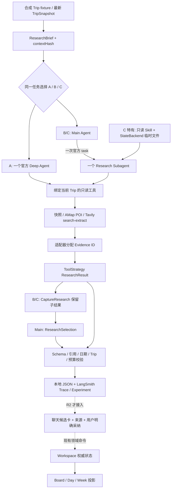

# R1 实际架构与 R2 接入边界

R1 是独立 CLI 研究实验，产品 Workspace 的三视图、数据库和采纳 API 保持原有权威。架构实验 A/B/C 使用相同 ResearchBrief、数据工具、输出 schema 和总预算。**R1 通过不要求 Subagent 获胜**；选择由可复查结果决定。

| 模式 | 复杂研究 | 简单状态问题 | 希望测出的代价/收益 |
|---|---|---|---|
| A | 一个 Deep Agent 使用只读工具并返回 ResearchResult | 直接读取快照 | 更少协调开销，可能更可靠、更便宜 |
| B | Main 读取快照后 task 委派唯一 Research；CaptureResearch 保留子代理结构化结果，Main 仅返回 ResearchSelection | 不委派 | 上下文隔离是否提高质量，是否引入额外 token/失败 |
| C | B + travel-research Skill + 内存文件读写 | 不加载研究文件流程 | 工作步骤与笔记是否有实际收益，额外调用是否值得 |

共同限制：180 秒、12 次模型尝试（父子共享）、最多一次 Research 委派、AMap 3 次、网页搜索 4 次、提取最多 5 页、Tavily 6 credits。框架自动 general-purpose 子代理和 execute 不作为开放能力。失败请求计数，禁止以内部重试绕开上限。

ResearchBoundary 是官方 Middleware 上的授权/预算策略；模型循环、task、结构化输出和文件工具仍由框架提供，不是自建 Harness。工具本身也必须绑定 Trip 并校验参数，不能仅依赖模型看到的工具列表。

当前 B/C 使用公开 `aafter_agent` 钩子的 CaptureResearch 深拷贝子代理 ResearchResult；Main 只输出 `useResearchResult` 和 `explanation`，服务端验证同意后原样使用该子结果，不让 Main 重新抄写候选/引用。ToolStrategy 的公开错误处理回调最多允许一次结构修复，仍消耗共享12次模型预算，不是任意重试。

Qwen基线客户端在构造时设置streaming=True、max_tokens=5000、timeout=75、max_retries=0；总调用仍限180秒。基线模型输入保护150KB，兼容性候选统一40KB，预算另留50KB框架/schema余量；字节限制不是供应商精确token计算。当前已移除“第9次调用一律撤下工具”的人为收敛策略：从第7次调用起，经公开Middleware附加剩余预算提示，要求为ResearchSelection预留一次。12次硬上限、来源配额及执行权限不变；配额耗尽时仍动态撤下相应工具，执行时检查allowed和offered。历史策略及纠正依据见[model-comparison.md](model-comparison.md)。

## 数据与信任层

- **TripSnapshot**：领域数据的只读输入；历史聊天不能覆盖它。
- **ResearchBrief**：快照、用户问题、taskId、direct/research 模式、contextHash。混入不同 Trip 对象时拒绝。
- **Evidence**：适配器生成 ID、摘要、URL/providerId、检索时间、内容哈希、验证层级。search_excerpt 不等于读过原文；page_extract 不等于事实已审定；POI 不等于真实体验。
- **ResearchResult**：summary、候选、fact/experience/inference claims、引用、取舍、未知信息和 complete/partial/no_results。候选还不是 Idea 或 Activity。
- **Suggestion / ResearchRun**：R1 不写入产品。R2 应新增关联记录并连接现有 Suggestion，在用户采纳时重新检查 Trip、最新 contextHash、日期和幂等条件。

有效引用只证明该 ID 存在于工具结果，不能证明对应文字语义成立。日期相关开放、预约、设施和广告属性仍需要来源检查与人工判断。

Candidate.proposedDate现为Pydantic `date | None`，JSON只接受单一日期或null；“11月3日或4日”等含解释/备选日期不能进入已验证结果。仍另查日期位于Trip范围内。

候选模型现已使用官方ChatOpenAI 1.7.2、ChatDeepSeek 1.1.1、ChatAnthropic 1.7.6适配器构造；独立兼容性CLI只组织测试案例，复用同一Deep Agents图。四个真实模型/固定工具试验不是实际旅行来源评测；Claude因当前ToolStrategy强制工具选择不兼容而在调用前排除，模型列表请求另有HTTP403。产品默认模型未据此切换，架构未定案。详情见[model-comparison.md](model-comparison.md)。

`read_pages(evidence_id: str)` 现在接收一个已观察的网页证据ID，由服务端映射URL后提取。它不让模型拼接URL数组，避免真实Qwen把数组编码成字符串而反复失败；未知ID不会触发网络请求。底层适配器仍检查URL及总页面额度。

## 文件、记忆和异步生命周期

R1 C 的 StateBackend 文件只在本次调用中有效；只读 Skill 和临时笔记不是用户文档库，不挂载仓库、.env 或宿主 Shell。没有用户级自动长期 Memory；偏好继续来自 Trip。

当前 ainvoke 是异步 Python 调用；B/C 的 task 是当前图内的同步委派语义。官方 AsyncSubAgent 依赖 Agent Protocol 的 graph/run/thread 服务与任务工具，见 [异步子代理文档](https://docs.langchain.com/oss/python/deepagents/async-subagents)。R1 没有部署该服务，不能声称后台任务已能持久恢复。

R2 的 queued/running/completed/partial/failed/cancelled 是产品生命周期：每 Trip 一个活动研究，允许手动编辑，记录旧快照哈希；刷新恢复记录、进程重启把未完成记录标为失败，不承诺断点继续。未来采用正式 async API 时必须映射产品 run 与框架 run。

不引入独立 Planning/Verifier/Writer 角色、队列、微服务、向量库或 RAG。工具返回内容视为不可信资料；只读能力、受控来源、服务端 schema 校验、引用集合与用户采纳共同维护边界。

源码：[research.py](../../apps/api/agent/research.py)、[research_contracts.py](../../apps/api/agent/research_contracts.py)、[research_sources.py](../../apps/api/agent/research_sources.py)。正式 API：[Subagents](https://docs.langchain.com/oss/python/deepagents/subagents)、[Permissions](https://docs.langchain.com/oss/python/deepagents/permissions)。
