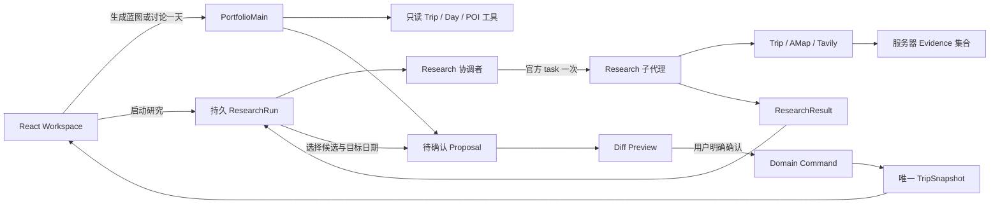

# Portfolio 开发者学习指南

更新：2026-10-26。范围是当前 Portfolio 实现，旧 [课程对应表](course-mapping.md)、R1 实验与 [模型对照](model-comparison.md)继续保留。本文解释实际代码，不把已有兼容性试验当作完整产品验收。作者亲自讲解、真人推荐质量评审：**Pending**。

## 从一次点击理解系统



图中的分支不是多个长期 Agent 服务。它们仍运行于一个本地 FastAPI 应用，SQLite 保存状态。Main Chat 保留原会话；显式蓝图/当天操作使用 `PortfolioMain`；深入研究使用一个协调者和一个 Research 子代理。没有额外规划师、评审师、RAG、向量库或自写模型循环。

| 层与阅读入口（相对仓库根目录） | 实际职责 | 不能据此声称 |
|---|---|---|
| `apps/web/src/PortfolioTools.tsx`、`ProposalDiffPanel.tsx` | 发起、轮询、显示来源、候选转 Proposal、明确确认 | UI 展示成功不等于推荐正确 |
| `apps/api/agent/portfolio.py` | `generate_proposal` / `research_for_trip` 绑定快照、模型、工具、Trace、输出校验 | Agent 可直接操作数据库 |
| `apps/api/agent/research.py` | `create_deep_agent`、正式 `task`、`ToolStrategy`、公共 Middleware | 已证明 B 优于所有单 Agent 实现 |
| `apps/api/agent/research_sources.py` | 高德与 Tavily 适配、来源额度、Evidence、模型可见摘要 | 搜索摘要等于已核实预约规则 |
| `apps/api/agent/research_contracts.py` | ResearchBrief / Result / Evidence；引用与日期验证 | 确定性验证能证明事实为真 |
| `apps/api/routes/portfolio.py` | 请求生命周期、后台任务、取消、启动恢复 | 已使用远程 AsyncSubAgent / Agent Protocol |
| `apps/api/db/repository.py`、`domain/commands.py` | 事务、版本、上下文过期、用户确认后的正式写入 | ResearchRun 是第二套权威行程 |
| `apps/api/domain/day_context.py`、`routes/maps.py` | 时间重叠、未定时间、地点缺口、路线参考与高德静态地图 | 有坐标就知道实时交通或可预约性 |

## Main、Research 与官方框架的分工

简单规划直接调用读取工具：蓝图读取当前 Trip；当天调整还必须成功读取选中日期的 `get_day_context`。`ToolStrategy(ProposalDraft)` 返回结构化动作。服务端检查日期、已有活动 ID、地点是否来自已观测 POI、重复安排及当天范围，再保存待确认方案。地点未知允许 `place=null`；不会伪造坐标填满地图。

复杂研究用当前 B 配置：协调者先读同一 Trip，再通过官方 `task` 委派 `research` 一次。Research 有独立消息上下文、`TodoListMiddleware` 和只读来源工具。`CaptureResearch.aafter_agent` 保留子代理原始结构化 `ResearchResult`；协调者只返回 `ResearchSelection(useResearchResult, explanation)`，避免重新誊写事实和证据。选择 B 是当前产品组装，不是已完成 A/B/C 胜负证明。

框架负责调用循环、工具调度、结构化输出修复。项目的 `ResearchBoundary` 是公共 Middleware：限制实际可执行工具、统计父子共享请求、提示剩余预算并校验输入大小；不是另写一个 Agent Harness。当前限制包括共享 12 次模型请求、一次结构化修复、来源查询配额和整体超时；具体数值以 `portfolio.py` / `research.py` 常量为准，不通过无限重试追求成功。

课程对应：M1.3 模型适配器、M1.5 工具、M4.1 委派、M5.3 应用组装。详细本地课程路径、0.7.0 教学版本与本项目 0.7.32 的差异见 [course-mapping.md](course-mapping.md)。官方入口：[Deep Agents](https://docs.langchain.com/oss/python/deepagents/overview)、[课程源码](https://github.com/langchain-ai/lca-deepagents)。项目锁定 Deep Agents 0.7.32、LangChain 1.4.7、LangGraph 1.2.17；第三方来源与许可见 [DEPENDENCIES.md](../DEPENDENCIES.md) 和 `uv.lock`。

## Context、Backend、Skills 与记忆

每次请求拿到 detached `TripSnapshot`，其中偏好、同行人、已确认活动和 Ideas 作为约束。工具不接受任意 Trip ID；当前用户文字和网页是数据，不能授予写入权限。`context_hash` 排除时间戳、版本和未采纳 Suggestion 等记账字段，保留实际旅行内容；内容改变后，旧研究或方案不能覆盖新安排。

`StateBackend` 是官方图状态 backend，不是 SQLite，也不是长期用户记忆。Portfolio 规划禁用文件读写和执行；当前 Research B 不启用 C 的文件/Skills 能力。原 R1 C 的只读 Skill / 内存文件实验仍保留，但不能宣传成产品已具备个人长期记忆。聊天会话、研究记录与正式行程各有独立持久化目的。

上下文容量不是无限的。当前生产 `Sources.model_view` 给模型较短摘录，同时在服务器保留带检索时间、截断标记及内容 hash 的 Evidence；这与删除证据、伪造摘要不同。协调者只传用户问题及少量约束，Research 自己读快照。仍遇到上下文上限时必须失败并保留未改写状态，不能把失败包装成研究结论。本轮集成负责人已经通过一次真实山西 Research UI 闭环：partial、双林寺 1 候选，高德加新华网/人民网支持，开放与预约仍未知；确认采纳并刷新后保留。它是单次实际产品链路证据，不是全部研究质量验收，人工评审仍 Pending。

## Evidence 到确认写入

Research 工具只有 `get_trip_snapshot`、`search_places(query)`、`web_search(query)`、`read_pages(evidence_id)`。最后一个参数是已观测的单一证据 ID，由服务器映射 URL，不能任意读取用户输入的网址。生产来源限制为代码中的政府/官方机构/可信公共媒体域名；当前并不覆盖所有地方官方网站，小红书与社区内容没有作为可用依赖。

Evidence 保留来源类型、URL、publisher、retrievedAt、excerpt、verification、hash 和可选 Place。POI 支持位置，不支持营业、票务和体验结论。搜索摘录、页面摘录、事实、体验资料和推断分开显示；即使来自允许的域名，也要判断原文是否真正支持该论断、是否过期。UI 将快照和 POI 的 JSON 投影成可读摘要；原始资料、内部 ID 和 hash 仍可展开“技术详情”，不会因为界面简化删除证据。

Research Result 至少包含 summary、candidates、claims、limitations、coverage、status。候选的 `placeEvidenceRef` 必须指向实际 POI，并有 fact claim 引用允许的网页证据；服务端校验引用存在、日期在范围内。`no_results` 可以是合法无候选输出，但不是个性化推荐价值达标。

用户选择候选时，只提交 run ID、candidateIndex、目标 Ideas/Activity 和日期。服务器从存储的结果生成 Proposal，不接受客户端重写候选文字。确认命令再次检查版本、内容 hash、Trip 归属及是否已采纳；整个动作批次、Proposal 状态和采纳标记同一事务提交，一次增加 Workspace 版本。失败则整体回滚。原 Main Chat Suggestion 也接入同一 Diff 确认路径。

## 任务状态、Trace 与评审责任

`ResearchRun` 的 queued → running → completed / partial / failed / cancelled 是应用任务状态。`asyncio.create_task` 只管理本地任务；取消阻止迟到结果覆盖状态，启动恢复把中断任务标为失败。它没有声称实现课程 M5.4 的远程 AsyncSubAgent 持久运行协议。

真实 Portfolio 调用写入 `${LANGSMITH_PROJECT}-Portfolio`，并在 `data/portfolio-agent-runs/` 保留脱敏用量和诊断。Trace URL 生成与远程执行树成功核验是两件事；应逐条核对 Main/task/Research/工具、模型请求数、失败或修复节点。当前 `trace_client` 使用递归 `scrub` 清理密钥，不是隐藏全部旅行输入/输出；Trace 可能包含问题和旅行内容。不要公开私人 Trip 或将密钥放入截图。

| 验证层 | 谁执行 | 可以证明什么 |
|---|---|---|
| Schema、引用、日期、权限、版本、原子提交 | 自动测试 | 确定性约束 |
| 真实服务调用与 Trace 核验 | 工程执行并留记录 | 这次调用发生且链路可追溯 |
| 推荐合理性、证据支持强度、偏好贴合 | Codex 可整理样本；用户/Advisor 人工评审 | 人工结论仍 **Pending**，不得以 AI 分数代替 |

## 已亲自执行的最小学习实验

2026-10-26，项目根目录执行：

```powershell
.venv\Scripts\python -m pytest evaluation/test_portfolio_agent.py -q -k "day_changes_cannot_remove_other_day or unknown_trip_details_block_planning or observed_place_is_allowed"
```

实际 **5 passed, 32 deselected in 1.52s**。检查缺少目的地/完整日期在调用模型前被拒绝、当天方案不能删除别天、观测地点可用而篡改坐标不可用。使用合成快照/固定来源，无真实模型、无真实 Trace、零付费调用。Workspace 独立复现与修复另见 [review-portfolio-workspace.md](review-portfolio-workspace.md)。

作者可用代码回答三个问题：为什么提示词不能代替权限；为什么子代理输出不能直接成为正式行程；为什么合法 JSON 与真实好推荐不同。材料已提供，作者亲自完成讲解及人工质量签收仍 **Pending**。

真实山西研究依据：[公开运行摘要](../../evaluation/portfolio-evidence.json)（含成功、失败及来源索引）与 [LangSmith Trace](https://smith.langchain.com/o/4564f8ef-ab59-4775-ac79-da753311319b/projects/p/e870c339-03be-495b-b386-3a053d4edc07/r/6940d27e-4b3f-452e-b709-c94997f9b32f?poll=true)（需对应账号权限）。结果由集成负责人核验；本文未额外发起模型或来源调用。
